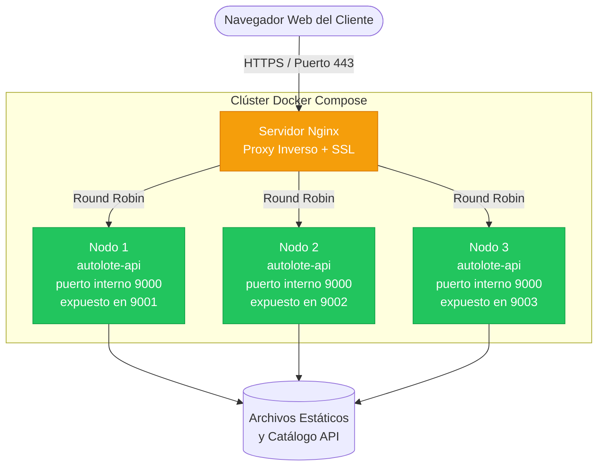

# J&L Imports - Autolote de Importación (GSW)

## 🏗️ Diagrama de Arquitectura

El siguiente esquema representa la integración del servidor proxy inverso con HTTPS y el clúster de alta disponibilidad en Docker. Nginx reparte las peticiones entre los 3 nodos (activo-activo, round robin) y, si un nodo cae, deja de enviarle tráfico.

